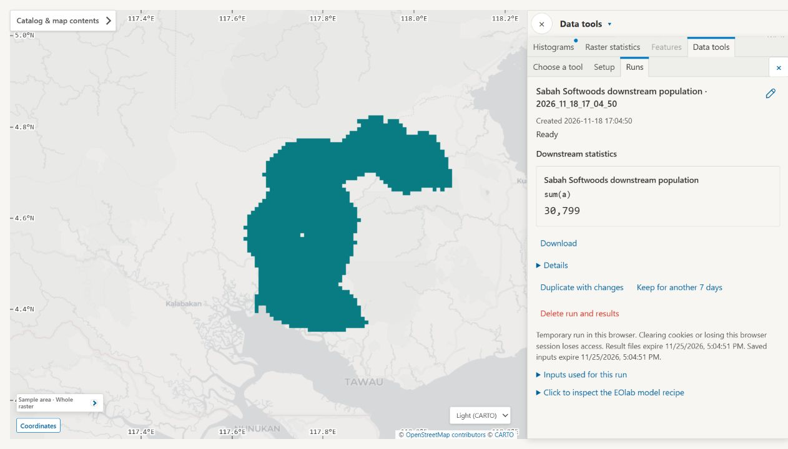

# EOLab

EOLab is an open-source mapping tool for environmental teams. Track rainfall through time, measure forest biomass inside a proposed corridor, or estimate how many people live downstream of a restoration site. Workshop participants can open a shared map in their browsers and add field observations without creating an account.

[Feature tour](#feature-tour) · [Deploy EOLab](#deploy-eolab) · [AI deployment prompt](#ask-an-ai-for-deployment-help)


*Sabah, Malaysia. Few places in this 100 × 100 km sample had both high aboveground biomass and a heavy human footprint. Those places would appear in the upper-right corner of the chart.*


*PACHA workshop, Bolivia. A participant outlined a patch of dry forest that still showed damage from a 2019 fire. Anyone opening the workshop map can read the note at that spot.*

## Feature tour

[Catalog and styles](#find-datasets-and-build-a-map) · [Pixel values and histograms](#inspect-a-place-and-compare-measurements) · [Area statistics](#calculate-statistics-for-an-area) · [Feature plots and polygon summaries](#plot-attributes-and-summarize-polygons) · [Time series](#follow-observations-through-time) · [Raster clips](#clip-and-download-a-raster) · [Environmental models](#run-environmental-models) · [Parcel planning](#configure-a-parcel-planning-tool) · [Drawing and sharing](#draw-upload-and-share) · [Run results](#keep-the-results-of-a-run)

### Find datasets and build a map

Search the **Catalog** by place name, filename, keyword, author, paper title, or DOI when that information appears in the dataset description or its supporting-file metadata. Choose **More details** to check a source or **Add to map** to display it. **Surprise me** opens a random result from the current search.

<details>
<summary>Catalog search examples</summary>

- `flood type:raster date:2020` finds raster datasets matching “flood” with observations in 2020. Use `date:2020-01..2020-03` for an inclusive range.
- `category:"Coastal protection"` matches that category label. A plain word such as `coastal` searches more broadly.
- `type:vector` finds mapped features such as watersheds, `type:temporal` finds observations over time, and `type:nonspatial` finds tables and documents. `format:cog` finds Cloud Optimized GeoTIFFs.

</details>

In **Map contents**, show, hide, rename, or reorder layers. The first layer draws on top. Duplicate a layer to try a second style or filter and keep both views. Copy a style between compatible layers, and use the legend to show readers what the colors mean.

The panels fade together so you can see the map beneath them. Hover over a panel or move keyboard focus into it to bring all panels back to full opacity. When you click the map to inspect a histogram or feature, the visible result stays readable as you pan or sample another spot. Close it, minimize it, or switch tools to let it fade again. Open **Settings** at the bottom of the map tools menu to turn fading off or adjust the delays, fade durations, and idle opacity. EOLab remembers your choices in this browser.

<details>
<summary>Color scales, category names, and vector labels</summary>

Use a color range for continuous measurements such as rainfall, named colors for land-cover classes, or symbols and labels for vector features. A percentile stretch makes differences visible when a few extreme values dominate the range. Turn on **Style one value separately** to give a value its own color and opacity. For example, set a flood depth of `0` to 0% opacity to show the map underneath. Use **Add color range** to style a range including its endpoints. Enter only **Through** to style everything at or below `1`, or only **From** to color everything at or above `100` magenta. The exact value takes priority, followed by the first matching range. Other values use the gradient. You can import category names and colors from CSV. [See the style editor.](docs/images/eolab-dynamic-styling.jpg)

</details>

### Inspect a place and compare measurements

Use the map tool strip to choose **Pan**, **Pixel picker**, **Histogram box**, or **Lasso**. Pixel picker reads raster values and inspects vector features at a click. Use **Previous** and **Next** in **Feature inspector** when features overlap. Results stay in the right panel. **All tabs** lists views that don’t fit across the top.

For **Lasso**, choose a vector layer, drag around an area and release. EOLab selects whole original features that intersect the polygon, including boundary touches. Existing layer filters still apply. The strip shows the exact count and highlights the selected features when they fit the display budget. Draw again to replace the selection, use **Clear selection** to remove it, or press **Esc** to cancel unfinished work. Choose **Pan** to move the map, or press **P** to return to Pixel picker.

Choose **Histogram box** to place the sampling box at a click, or open **Histograms** for saved polygons. Enter the box width in kilometers or hold **Alt** and scroll to resize it. **1D** plots the distribution for each visible raster. A log scale makes small bars easier to see. **2D** compares the top two visible continuous rasters. Reorder the layers to change the pair or swap X and Y. Larger squares show more common pairs of values. Matching colors locate them on the map.

For a categorical raster, point at a cell to read its class and code. The chart estimates hectares and percentage of valid area for each class. Missing pixels are excluded. A valid code with no class label is counted as **Unmapped**.


*In this 200 × 200 km sample around Sicily and southern Italy, intensive land use accounts for 31.5% of the area with data. Land and marine classes both count toward the total.*

### Calculate statistics for an area

Open **Raster statistics** to see a value for one raster or a plot for a stack. The raster name or count opens the layer choices, including hidden rasters. The area name opens choices for a sampling box, selected polygons, or each raster’s full extent. **Values** shows the underlying numbers, and **Download CSV** exports them.

<details>
<summary>Example formulas, thresholds, and exact statistics</summary>

Open **Choose statistics** to add a built-in measure or write a formula. For example, `mean(a)` gives the average valid value, `areaha(a > 10)` gives hectares above 10 in the raster’s units, and `pixelValue(a)` reads the last point you clicked. EOLab evaluates up to five formulas for each selected raster. Large sampling boxes can show an **Estimated** mean, standard deviation, or percentage above a threshold. Choose **Calculate exact** to use the original pixels.

</details>

For a calculation you want to follow in **Runs**, use **Data tools → Raster summary** to evaluate one statistic or formula for a raster and an area.

### Plot attributes and summarize polygons

In the **Feature inspector**, **Plot this feature** graphs numeric fields from one feature. **Compare features** plots one or more fields across the features under your map click. Each comparison field has its own scale and shares the same X axis. Switch between **Plot** and **Values** to read exact measurements, including missing values. Click another place to update the open plot, or select a measurement and choose **Zoom to feature**. **Plot options** contains the chart style, order, and axis or title field.

In **Compare features**, use **Previous selection** and **Next selection** to revisit earlier map clicks, including after a click that cleared the plot. If you go back and select a different set of features, the forward history clears.

Use **Layer stats** to show the mean, minimum, or maximum of each plotted field beside the selected values. Each statistic uses all numeric values in its original layer, including features outside the current view or filter.


*Each point comes from a different field on the same feature. The value in R2003 is lower than the value in R2000, a dip that is easy to spot when the 25 fields are plotted together.*

Use the calculator on a custom vector layer to create a numeric field. For example, `'Population' / 'Area km2'` gives population density. You can filter or style the layer using the new field and save it with the map. **Treat numeric text as numbers** accepts values stored as text. Missing inputs and division by zero produce a missing result.

Use **Data tools → Vector summary** to group polygons by an attribute such as state name. Calculate sums, means, minima, maxima, or standard deviations for one or more fields, and merge each group’s outlines. Choose all features or the layer’s filter. Display the result on the map or download it as a GeoPackage. Adjusting boundary detail changes how the outlines look while preserving the statistics.

### Follow observations through time

Find a dataset with `type:temporal`. In **Map contents**, choose a variable, month, and observation time in UTC. Duplicate the layer to compare two dates or variables with different styles.

Use the timeline at the bottom of the map to drag through a month or press **Play**. Choose **First observation each day** to see changes over a longer period. The arrow buttons step across available months and skip missing observations. When several time layers are visible, use **Layer** to choose which one moves. The **On map** time appears when that observation has drawn.


*Rainfall at 06:00 UTC on July 1, 2026. A band of rain crosses the tropical Atlantic toward West Africa. Choose another available hour to see how the pattern changes.*

- **Create a raster from a time series** summarizes a period into a map. A second map counts the valid observations behind each pixel. For suitable hourly rainfall rates, **Precipitation total** gives accumulated depth in millimeters.
- **Time series for an area** calculates a mean, maximum, or standard deviation for each available observation. For example, download a CSV of mean temperature in a watershed over time.
- **Raster statistics** plots statistics or formulas across the dates you select. Compare an area average with a value at a clicked point, or download the plotted values as CSV. You choose the calculation dates independently of the hour displayed on the map.

Ordinary period statistics weight available observations equally. Gaps remain missing, so check observation counts before comparing periods.

### Clip and download a raster

In **Map contents**, select **Download** on the raster you want. The panel opens beside that layer. Choose **Visible map area** to use the view captured when you opened the panel, **Entire raster** to export the full extent, or a sampling box or selected polygons. Select **Prepare GeoTIFF**, then **Download GeoTIFF** when it is ready. Select the same layer’s **Download** again to close the panel while preparation continues.

In **Data tools**, choose **Raster clip**, select a raster, and set the area to the visible map, a sampling box, or selected polygons. Choose **Run tool**. When it finishes, download **Clipped raster** from **Runs**. The GeoTIFF keeps the source pixel size and values.

<details>
<summary>See the finished biomass clip and GeoTIFF download</summary>


*This Sabah clip is a 15.7 MiB GeoTIFF. The team can take the selected area into desktop GIS or show it on the map.*

</details>

### Run environmental models

**Downstream ecosystem beneficiaries** maps where water flows from a selected area. Overlay population data to estimate how many people are in the downstream footprint of a proposed restoration site.



*Sabah, Malaysia. In this example, EOLab mapped the area downstream of a selected corridor and estimated that about 30,800 people were within it using LandScan 2023 population data.*

**Ecosystem Condition** learns how environmental conditions relate to observed habitat at reference sites. It maps how closely the rest of the analysis area matches those expectations. **Reference similarity** ranges from 0 to 1, with higher values indicating a closer match. Download the 500 m map and diagnostics to examine places where observations depart from expectations. [See the model inputs.](docs/images/eolab-model-habitat-condition.jpg)

<details>
<summary>Choose reference sites and prepare Ecosystem Condition inputs</summary>

Use the original Google Earth Engine inputs for a prepared area and assessment year, or supply your own predictor and habitat-response rasters. With the original inputs you can select datasets separately for each role. SRTM landforms and at least one observed response are required. [Original model and data sources](https://github.com/springinnovate/nhi-terrestrial-integrity-modeling)

For reference sites, select saved polygons or a raster mask. With a Catalog raster mask, valid finite nonzero values inside the area designate reference sites. For an uploaded mask, use a single-band Byte GeoTIFF with its own coordinate system, `1` for reference sites and `0` elsewhere. NoData is excluded. The output uses the equal-area EPSG:6933 grid.

Administrators can open **Manage cached inputs** in model setup or visit `/admin-eolab`. Choose a Catalog polygon area and year, check coverage, and prepare missing tiles. Downloads continue after the page closes. Return to check progress, retry missing inputs, or download a preparation report. Locations without prepared data have no result, and the model needs enough usable reference sites to fit.

</details>

### Configure a parcel planning tool

Use **Planning tools** to define an area, a parcel layer, and the interventions a participant can assign. Use polygons drawn in EOLab or custom copies of Catalog polygon layers for either choice. One layer can supply both. For Catalog parcels, choose an original text or integer field with a unique, nonempty ID for each parcel. Drawn parcels have built-in IDs, so their names can repeat. The browser that created the tool can edit its configuration.

Finish or cancel any polygon in progress before saving the tool. EOLab saves the selected drawings on the site. When you reopen a tool, remembered map, or published map linked to a drawing, it loads the latest saved polygons. Each view keeps its own layer name, filters, and style. Removing a layer from the map leaves its saved drawing available.

The **Planning API** lets participants save private scenarios with one intervention per parcel. Its reference is at `/docs`. After the first scenario, the parcel dataset, ID field, and existing intervention names stay fixed. You can still add interventions or change the area and filters. Deleting a drawn parcel keeps its assignment. You can clear the assignment or undo the deletion to restore the parcel with its assignment.

### Draw, upload, and share

- **Sketch a boundary.** Choose **Map contents → Draw polygon**, draw the outline, add notes, and save. You can also import existing outlines from GeoJSON or download your drawings in that format.
- **Bring a project boundary.** Under **Your uploads**, add a GeoPackage containing one polygon layer to keep its attributes. Filter it to a country, watershed, or project group and use that selection for statistics or a model.
- **Reshape a copy.** In **Map contents**, duplicate a GeoPackage polygon layer, choose **Edit geometry**, then click a polygon. Drag its vertices, click an edge to insert one, or hover or focus a vertex and press **Delete**. **Save changes** keeps the edited layer in your browser’s private uploads. Each save uses a file slot for seven days.
- **Collect observations together.** Create a shared polygon layer or join one with a share code and contributor name. Everyone can see saved contributions and edit their own. **Share layer** makes a private drawing available for collaboration. Saved drawings and their filters can also define an analysis area.
- **Publish a map.** Choose **Publish map**, give the map a title and link name, and select **Create map link**. The link opens the same layers, styles, order, and starting view. Older `#view=` links no longer open a saved map. If you still have the original map, publish it to get a named link. Shared drawings update as contributors save. **Reset view** and **Undo reset** let you clear and restore your browser’s map.

<details>
<summary>Which files stay private, what expires, and what a download includes</summary>

Drawings stay on this device until you share their layer or save them through Planning. A linked tool or published map gives others read access to the saved drawing. Only the browser that created it can edit its polygons. GeoJSON imports accept simple WGS84 polygons without holes, including names and notes. A GeoJSON download includes all saved polygons in the layer, including those hidden by its filter.

If an upgrade reports a missing drawing position in **Map contents**, keep the browser's site data. Ask the site operator to reopen the same site with the previous version. In that browser, download each layer as GeoJSON and save a change to the drawing layer order before upgrading again.

The server stores private uploads for seven days. The default per-browser limits are 100 files and 500 MiB total across GeoPackages and reference masks. **Your uploads** shows the limits for your deployment. An accepted calculation can finish using a file that expires while it runs. Private uploads, local drawings, analysis charts, and run files stay with their owners.

</details>

### Keep the results of a run

Follow progress in **Runs** while you work. Choose **Cancel run** to stop a calculation, **Show on map** to inspect a supported output, or **Duplicate with changes** to try other inputs. Some tools accept a previous run’s raster. Runs are private to your browser and expire on the date shown. Download files to keep them or choose **Keep for another 7 days**.

## Deploy EOLab

Start with Docker Compose and a folder on the Docker host containing a georeferenced GeoTIFF or a GeoPackage with a map layer. Set `EOLAB_SCAN_MOUNT_PATH` to the folder’s absolute path. EOLab mounts it read-only. Set the database password, separate GeoServer admin and master passwords, and the Jobs token using the formats in [.env.example](.env.example).

To adjust the upload allowance per browser, set `EOLAB_UPLOAD_OWNER_MAX_FILES` for the file count and `EOLAB_UPLOAD_OWNER_MAX_BYTES` for the total storage in bytes.

### On your computer

Copy `.env.example` to `.env` in a fresh checkout and fill in the settings above. From the repository root, start the services with the [local Compose file](docker-compose.local.yml).

```sh
docker compose -f docker-compose.yml -f docker-compose.local.yml up --build --detach
```

Open `http://localhost:8000`.

### On Coolify

Connect this repository with the Docker Compose build pack and select [docker-compose.yml](docker-compose.yml). Enter the settings from `.env.example` in Coolify. Enable **Include Source Commit in Build** and route your HTTPS domain to the `app` service on port `8000`. Keep the other services private. [Coolify setup guide](https://coolify.io/docs/applications/builds/docker-compose)

### Check your first map

Open **Status** and choose **Scan directories**. When the scan finishes, find your file in the **Catalog**, choose **Add to map**, and check that the layer draws in the expected place.

### Ask an AI for deployment help

Open an AI assistant in this checkout, fill in the brackets, and paste this prompt.

```text
Help me deploy EOLab on [operating system] using [local Docker Compose or Coolify]. My data folder on the Docker host is [folder], and the site address is [localhost or domain].

Read .env.example, docker-compose.yml, and docker-compose.local.yml. Give me the settings and commands for my setup. Use placeholders for secrets and show me how to generate them on the host. Walk me through checking /healthz and displaying one of my files on the map. If either check fails, tell me which service log to inspect.
```

<details>
<summary>Upgrade an existing site</summary>

Before upgrading, ask your site operator to [check which published maps need attention](scripts/saved-map-upgrade/). Some older maps and links need to be recreated. Keep the map settings and shared-layer invitations you will need to republish. Shared drawings and their notes stay in their layers. The [Site Condition migration](src/eolab_app/saved_maps/migrate.py) preserves that map's URL and shared drawings. Preview the migration, apply it using the reviewed revision, then reopen the same URL and check the shared drawings.

Back up the Docker volumes and keep their names and the database password. Let active runs finish. Stop the old `app` and `processing-worker` containers before starting replacements. Run one worker per site and use separate volumes for each deployment.

</details>

### Prepare data for the Catalog

<details>
<summary>Add dataset descriptions, citations, and supporting files</summary>

Place a `*.eolab.yaml` file beside its data to add titles, citations, categories, or supporting files to the STAC (SpatioTemporal Asset Catalog). A description can also make a nonspatial table or document searchable. Use paths relative to the description and within the data mount. Rescan after edits. Temporal datasets use a separate `dataset.yaml` to describe their observations. [Metadata examples](tests/fixtures/catalog_descriptors) · [Metadata schema](catalog/schemas/eolab-item-v1.schema.json) · [Temporal dataset example](docs/dataset-examples/dataset.yaml)

</details>

<details>
<summary>Make large polygon layers draw faster</summary>

Use the overview script to build a GeoPackage with simpler outlines for display at regional scales. Exact calculations still use the original polygons. The input needs a spatial index and a projected coordinate system in meters. Run the script with GDAL-enabled Python, copy the new file into the data folder, and scan it. [Polygon overview script](scripts/prepare_vector_overviews.py)

```sh
python scripts/prepare_vector_overviews.py original.gpkg prepared.gpkg --layer protected_areas --tolerances 10 100 1000 5000
```

</details>

## License

EOLab uses the [Apache License 2.0](LICENSE). Color palettes for comparing two rasters come from the [ESOS-C data viewer](https://github.com/springinnovate/esos-c-dataviewer) under the [same license](https://github.com/springinnovate/esos-c-dataviewer/blob/main/LICENSE).
