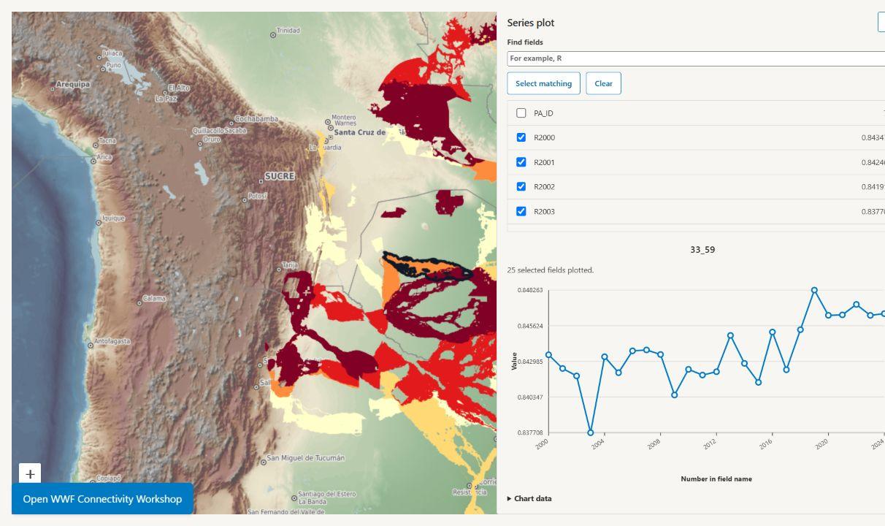

# EOLab

EOLab is an open-source mapping tool for environmental teams. Track rainfall through time, measure forest biomass inside a proposed corridor, or estimate how many people live downstream of a restoration site. Workshop participants can open a shared map in their browsers and add field observations without creating an account.

[Feature tour](#feature-tour) · [Deploy EOLab](#deploy-eolab) · [AI deployment prompt](#ask-an-ai-for-deployment-help)


*Sabah, Malaysia. Few places in this 100 × 100 km sample had both high aboveground biomass and a heavy human footprint. Those places would appear in the upper-right corner of the chart.*


*PACHA workshop, Bolivia. A participant outlined a patch of dry forest that still showed damage from a 2019 fire. Anyone opening the workshop map can read the note at that spot.*

## Feature tour

[Catalog and styles](#find-datasets-and-build-a-map) · [Pixel values and histograms](#inspect-a-place-and-compare-measurements) · [Area statistics](#calculate-statistics-for-an-area) · [Feature plots and polygon summaries](#plot-attributes-and-summarize-polygons) · [Time series](#follow-observations-through-time) · [Raster clips](#clip-and-download-a-raster) · [Raster calculator](#calculate-a-raster-from-several-layers) · [Environmental models](#run-environmental-models) · [Parcel planning](#configure-a-parcel-planning-tool) · [Drawing and sharing](#draw-upload-and-share) · [Run results](#keep-the-results-of-a-run)

### Find datasets and build a map

Search the **Catalog** by place name, filename, keyword, author, paper title, or DOI when that information appears in the dataset description or its supporting-file metadata. Choose **More details** to check a source or **Add to map** to display it. **Surprise me** opens a random result from the current search.

<details>
<summary>Catalog search examples</summary>

- `flood type:raster date:2020` finds rasters dated 2020 in the Catalog that match “flood”. Use `date:2020-01..2020-03` for January through March 2020.
- `category:"Coastal protection"` matches that category label. A plain word such as `coastal` searches more broadly.
- `type:vector` finds mapped features such as watersheds, `type:temporal` finds observations over time, and `type:nonspatial` finds tables and documents.

</details>

In **Map contents**, show, hide, rename, or reorder layers. The first layer draws on top. Duplicate a layer to try a second style or filter and keep both views. Copy a style between compatible layers, and use the legend to show readers what the colors mean.

With `EOLAB_MAPTILER_API_KEY` configured in [the environment](.env.example), enter a country, city, or street address in **Find a place** and choose a match to zoom there. If you close the panel, choose **Map display → Show place search** from the map tool menu on the right.

The map tool menu shows **Choose a tool** or the active tool’s name. To keep the panels fully visible, choose **Settings** and turn off **Fade panels when idle**.

<details>
<summary>Color scales, category names, and vector labels</summary>

For a vector layer, choose **Categories** or **Numeric ranges** and select an attribute. Under **No value**, turn on **Style separately** to give features with missing values their own color in the legend.

Use a color gradient for continuous measurements such as rainfall. A percentile stretch reveals differences when a few extreme values dominate. To show the map through dry areas on a flood-depth layer, use **Style one value separately** and set the opacity for `0` to 0%. Use **Add color range** to highlight an interval. For categories such as land-cover classes, you can import names and colors from CSV. [See the style editor.](docs/images/eolab-dynamic-styling.jpg)

</details>

### Inspect a place and compare measurements

Use **Pan** to move around the map or **Picker** to read raster values and inspect features where you click. The button says **Pixel picker** when only raster picking is available. Choose **Features** from the map tool menu to see the selected features.

To show friendly field labels, units, or currency in **Features**, open **Field display** on a selected feature and choose **Download template**. Edit the CSV, then choose **Import field formats** to preview your changes. Applying the import replaces the display settings for that layer in your map.

To select several features, choose **Lasso**, pick a vector layer, and drag around the area you want to inspect. Cross your own line to select just the loop, or release to close the outline back to where you started. EOLab selects whole features that intersect the area and match the layer’s filters. Draw again to replace the selection or choose **Clear selection**.

Choose **Histogram box** to place the sampling box at a click, or open **Histograms** for saved polygons. Enter the box width in kilometers or hold **Alt** and scroll to resize it. **1D** plots the distribution for each visible raster. A log scale makes small bars easier to see. **2D** compares the top two visible continuous rasters. Reorder the layers to change the pair or swap X and Y. Larger squares show more common pairs of values. Matching colors locate them on the map.

For a categorical raster, point at a cell to read its class and code. The chart estimates hectares and percentage of valid area for each class. Missing pixels are excluded. A valid code with no class label is counted as **Unmapped**.


*In this 200 × 200 km sample around Sicily and southern Italy, intensive land use accounts for 31.5% of the area with data. Land and marine classes both count toward the total.*

### Calculate statistics for an area

Open **Raster statistics** to see a value for one raster or compare several rasters in a plot. The raster name or count opens the layer choices, including hidden rasters. The area name opens choices for a sampling box, selected polygons, or each raster’s full extent. **Values** shows the underlying numbers, and **Download CSV** exports them.

<details>
<summary>Example formulas, thresholds, and exact statistics</summary>

Open **Choose statistics** to add a built-in measure or write a formula. For example, `mean(a)` gives the average valid value, `areaha(a > 10)` gives hectares above 10 in the raster’s units, and `pixelValue(a)` reads the last point you clicked. EOLab evaluates up to five formulas for each selected raster. Large sampling boxes can show an **Estimated** mean, standard deviation, or percentage above a threshold. Choose **Calculate exact** to use the original pixels.

</details>

Use **Data tools → Calculate a raster statistic within an area** to calculate one summary value from the raster pixels in your chosen area, such as average elevation within a watershed. Selected polygons are treated as one combined area.

### Plot attributes and summarize polygons

In **Features**, **Plot this feature** graphs numeric fields from one feature. **Compare features** plots one or more fields across features selected by Picker or Lasso. To plot X against Y after a Lasso selection, open **Compare features**, use **Choose fields** to select Y, then choose **Scatter** and the X field under **Plot options**. Line, scatter, and bar comparisons give each field its own scale and share the same X axis. In either plot, choose **Stacked bars** under **Plot options** to put the checked fields into one horizontal bar per feature. Stack fields that use the same units. Switch between **Plot** and **Values** to read exact measurements, including missing values.

For large selections, use **Features shown** to page through the comparison or **Plot all** to draw every feature. Select a mark to inspect its feature. In **Values**, use **Zoom to feature** to find it on the map when a location is available.

In **Features** or **Compare features**, use **Previous selection** and **Next selection** to revisit a Picker or Lasso selection. **Previous** and **Next** step through features within it.

Use **Layer stats** to show the mean, minimum, or maximum of each plotted field beside the selected values. Each statistic uses all numeric values in its original layer, including features outside the current view or filter.



*Each point comes from a different field on the same feature. The value in R2003 is lower than the value in R2000, a dip that is easy to spot when the 25 fields are plotted together.*

Use the calculator on a custom vector layer to create a numeric field. For example, `'Population' / 'Area km2'` gives population density. You can filter or style the layer using the new field and save it with the map. **Treat numeric text as numbers** accepts values stored as text. Missing inputs and division by zero produce a missing result.

Use **Data tools → Group polygons and calculate field statistics** to group polygons by a field such as state name. Calculate sums, means, minima, maxima, or population standard deviations for selected numeric fields, and merge each group’s outlines. Each feature's valid field value has equal weight. Choose all features or the layer’s filter. The result contains one GeoPackage feature per group. **Boundary simplification** changes the outlines while preserving the statistics; use 0 to keep detailed merged boundaries.

### Follow observations through time

Search the **Catalog** for `type:temporal` and add a layer to the map. In **Map contents**, choose a variable and an available observation. Duplicate the layer to compare two dates or variables.

Use the timeline arrows to step through observations or press **Play**. **On map** shows the observation currently displayed. For hourly data, choose **First observation each day** to see daily changes. If several time layers are visible, use **Layer** to choose which one to play.


*Rainfall at 06:00 UTC on July 1, 2026. A band of rain crosses the tropical Atlantic toward West Africa. Choose another available hour to see how the pattern changes.*

- Use **Data tools → Map a statistic per pixel for a time period** to find, for example, the highest temperature at each pixel during a month. The second map shows **Valid observations per pixel**. For compatible precipitation-rate data, **Total precipitation (mm)** estimates rainfall over the selected hours.
- **Export area statistics over time (CSV)** calculates a statistic across an area's valid pixels for each available observation, such as mean temperature within a watershed over time. The CSV contains one row per observation, including valid pixel counts.
- **Raster statistics** plots statistics or formulas across the dates you select. Compare an area average with a value at a clicked point, or download the plotted values as CSV. You choose the calculation dates independently of the hour displayed on the map.

For a measure such as the mean, each available observation has equal weight. Check observation counts before comparing periods with gaps.

### Clip and download a raster

In **Map contents**, select **Download** on the raster you want. Choose **Visible map area** for the view you had when you opened the panel, **Entire raster** for its full extent, or a sampling box or selected polygons. Select **Prepare GeoTIFF**, then **Download GeoTIFF** when it is ready.

In **Data tools**, choose **Clip a raster to an area**, select a raster, and set the area to the visible map, a sampling box, or selected polygons. Choose **Run tool**. When it finishes, download **Clipped raster** from **Runs**. The GeoTIFF keeps the source pixel size and values.

To clip to several polygon layers, open **Map contents → Polygon groups → New polygon group**. Name the group and select its layers. In **Clip a raster to an area**, choose the group under **Analysis area**. The clip uses the combined area of the features selected by each layer's filter, including layers hidden on the map.

<details>
<summary>See the finished biomass clip and GeoTIFF download</summary>


*This Sabah clip is a 15.7 MiB GeoTIFF. The team can take the selected area into desktop GIS or show it on the map.*

</details>

### Calculate a raster from several layers

In **Data tools**, choose **Raster calculator** and add rasters from **Map contents** or completed runs. If `a` is last year’s biomass and `b` is this year’s, `max(0, b - a)` maps gains and sets losses to zero.

Choose a resampling method for each input, an analysis area, and an output grid. Area functions such as `area_mean` use valid cells after resampling to that grid. A missing formula input or division by zero gives that cell NoData. Choose **Run tool**, then **Show on map** or **Download** in **Runs**.

### Run environmental models

**Upstream and downstream area** traces flow around selected polygons. Choose
a polygon layer and an elevation raster with square cells. Turn on **Upstream**
to find cells that drain into the polygons, **Downstream** to follow paths
leaving them, or both to combine the areas. The calculation fills depressions
and traces flow within the DEM. Valid DEM cells with centres inside the
selected polygons start the trace and are excluded from the result.

Choose **Run tool**. In the completed run, **Show on map** displays the mask
and **Download** saves it as a GeoTIFF. The mask keeps the DEM grid. A value
of 1 marks traced cells and 0 marks other valid cells. Missing elevation
remains NoData.

**Map downstream areas and summarize raster values** uses the WWF model to trace and buffer downstream flow from a starting area, then calculates a statistic from positive raster values within the resulting area. For example, sum a population raster to estimate how many people are within the downstream area of a proposed restoration site.


*Sabah, Malaysia. In this example, EOLab mapped the area downstream of a selected corridor and estimated that about 30,800 people were within it using LandScan 2023 population data.*

**Map ecosystem similarity to reference conditions** uses the **Ecosystem Condition** model to learn expected responses from environmental predictors at reference sites. It maps how closely observed responses across the analysis area match those expectations. The **Reference similarity score (0–1)** is higher where observations more closely match expectations. Download the 500 m map and model diagnostics to examine those differences. [See the model inputs.](docs/images/eolab-model-habitat-condition.jpg)

<details>
<summary>Choose reference sites and prepare Ecosystem Condition inputs</summary>

Choose **Prepared Earth Engine rasters** for an area and assessment year prepared by your administrator, or supply your own predictor and observed response rasters. After choosing a prepared area, select **Show analysis area on map** to zoom to its polygon and see the boundary while choosing reference sites. With the prepared inputs you can select datasets separately for each role. Select at least one predictor and one observed response. SRTM landforms are optional. For custom rasters, leave the categorical predictor set to **None** to treat all predictors as continuous. [Original model and data sources](https://github.com/springinnovate/nhi-terrestrial-integrity-modeling)

To inspect a published input, choose an **Assessment year** and expand the predictor or response group. Under the dataset, choose the variable if it has several, then select **Add to map**. You can inspect a layer even when its dataset is unchecked for the model.

For reference sites, select saved polygons or a raster mask. With a Catalog raster mask, valid finite nonzero values inside the area designate reference sites. For an uploaded mask, use a single-band Byte GeoTIFF with its own coordinate system, `1` for reference sites and `0` elsewhere. NoData is excluded. The output uses the equal-area EPSG:6933 grid.

Administrators can open **Manage cached inputs** in model setup or visit `/admin-eolab`. Choose a Catalog polygon area and year, check coverage, and prepare missing tiles. Downloads continue after the page closes. Return to check progress, retry missing inputs, or download a preparation report. Locations without prepared data have no result, and the model needs enough usable reference sites to fit.

</details>

### Configure a parcel planning tool

Use **Planning tools** to define an area, a parcel layer, and the interventions a participant can assign. Use polygons drawn in EOLab or custom copies of Catalog polygon layers for either choice. One layer can supply both. For Catalog parcels, choose an original text or integer field with a unique, nonempty ID for each parcel. Drawn parcels have built-in IDs, so their names can repeat. The browser that created the tool can edit its configuration.

Finish or cancel any polygon in progress before saving the tool. EOLab saves the selected drawings on the site. When you reopen a tool, remembered map, or published map linked to a drawing, it loads the latest saved polygons. Each view keeps its own layer name, filters, and style. Removing a layer from the map leaves its saved drawing available.

The **Planning API** lets participants save private scenarios with one intervention per parcel. Its reference is at `/docs`. After the first scenario, the parcel dataset, ID field, and existing intervention names stay fixed. You can still add interventions or change the area and filters. Deleting a drawn parcel keeps its assignment. You can clear the assignment or undo the deletion to restore the parcel with its assignment.

### Draw, upload, and share

- **Sketch a boundary.** Choose **Map contents → Draw polygon**, draw the outline, add notes, and save. Use **Download** on the layer card to keep a GeoJSON copy.
- **Bring a project boundary.** Under **Your uploads**, add a GeoJSON file or a GeoPackage containing one polygon layer to keep its attributes. Filter the layer to a country, watershed, or project group and use that selection for statistics or a model.
- **Reshape a copy.** In **Map contents**, duplicate a GeoPackage polygon layer, choose **Edit geometry**, then click a polygon. Drag its vertices, click an edge to insert one, or hover or focus a vertex and press **Delete**. **Save changes** keeps the edited layer in your browser’s private uploads. Each save uses a file slot for seven days.
- **Collect observations together.** Create a shared polygon layer or join one with a share code and contributor name. Everyone can see saved contributions and edit their own. **Share layer** makes a private drawing available for collaboration. Saved drawings and their filters can also define an analysis area.
- **Publish a map.** Choose **Publish map**, enter a title and link name, and choose what visitors can use, including **Style editing** and **Run models**. Select **Create map link** and share the **Public map link**. Keep the **Private edit link** safe. Anyone with it can edit the map and use **Save changes for everyone** to update the same public link.

<details>
<summary>Which files stay private, what expires, and what a download includes</summary>

A drawing stays on this device until you share its layer or save it through **Planning tools**. A published map or planning tool linked to a saved drawing lets others read the latest polygons. Only the browser that created the saved drawing can edit them. A GeoJSON download includes every saved polygon in the layer, even those hidden by its filter.

Private uploads are available to the uploading browser for seven days. **Your uploads** shows the limits for your site. The defaults are 100 files and 500 MiB per browser, including polygon files and reference masks. Uploaded GeoJSON counts toward the limit at its converted GeoPackage size.

</details>

### Keep the results of a run

Follow progress in **Runs** while you work. Choose **Cancel run** to stop a calculation, **Show on map** to inspect a supported output, or **Duplicate with changes** to try other inputs. Some tools accept a previous run’s raster. Runs are private to your browser and expire on the date shown. Download files to keep them or choose **Keep for another 7 days**.

## Deploy EOLab

Start with Docker Compose and a folder on the Docker host containing a georeferenced GeoTIFF or a GeoPackage with a map layer. Set `EOLAB_SCAN_MOUNT_PATH` to the folder’s absolute path. EOLab mounts it read-only. Set the database password, separate GeoServer admin and master passwords, and two distinct tokens for Jobs API callers and scheduler access using the formats in [.env.example](.env.example).

To adjust the upload allowance per browser, set `EOLAB_UPLOAD_OWNER_MAX_FILES` for the file count and `EOLAB_UPLOAD_OWNER_MAX_BYTES` for the total storage in bytes.

### On your computer

Copy `.env.example` to `.env` in a fresh checkout and fill in the settings above. From the repository root, start the services with the [local Compose file](docker-compose.local.yml).

```sh
docker compose -f docker-compose.yml -f docker-compose.local.yml up --build --detach
```

Open `http://localhost:8000`.

### On Coolify

Connect this repository with the Docker Compose build pack and select [docker-compose.yml](docker-compose.yml). Enter the settings from `.env.example` in Coolify. Enable **Include Source Commit in Build** and route your HTTPS domain to the `app` service on port `8000`. Keep the other services private. [Coolify setup guide](https://coolify.io/docs/applications/builds/docker-compose)

### Check your first map

Open **Status**, expand the **Catalog** row, and choose **Scan directories**. When the scan finishes, find your file in the **Catalog**, choose **Add to map**, and check that the layer draws in the expected place.

### Ask an AI for deployment help

Open an AI assistant in this checkout, fill in the brackets, and paste this prompt.

```text
Help me deploy EOLab on [operating system] using [local Docker Compose or Coolify]. My data folder on the Docker host is [folder], and the site address is [localhost or domain].

Read .env.example, docker-compose.yml, and docker-compose.local.yml. Give me the settings and commands for my setup. Use placeholders for secrets and show me how to generate them on the host. Walk me through checking /healthz and displaying one of my files on the map. If either check fails, tell me which service log to inspect.
```

<details>
<summary>Upgrade an existing site</summary>

Before upgrading, [check which published maps need attention](scripts/saved-map-upgrade/). Keep the map settings and shared-layer invitations for any maps you need to republish. If you still have the original map for an old `#view=` link, publish it again to get a **Public map link**. For the Site Condition workshop map, use the [migration command](src/eolab_app/saved_maps/migrate.py) to preserve its URL and shared drawings.

A site administrator can issue, replace, or revoke a **Private edit link** in **Published maps** at `/admin-eolab`.

If **Map contents** reports a missing drawing position after an upgrade, keep the affected browser’s site data. Reopen the same site on the previous version. In that browser, download each drawing layer as GeoJSON and save a change to the layer order before upgrading again.

Back up the Docker volumes and keep their names and the database password. Let active runs finish. Stop the old `app`, `jobs`, and `processing-worker` containers before starting replacements. Run one worker per site and use separate volumes for each deployment.

</details>

### Prepare data for the Catalog

#### Publish prepared Ecosystem Condition inputs

From an environment with GDAL's Python bindings and the scientific package in
[`deployment/application-habitat-requirements.txt`](deployment/application-habitat-requirements.txt),
run the [cache publisher](scripts/publish_habitat_cache.py) on the extracted
`habitat-cache` folder. Give it a separate output folder on the instance's
catalog data mount. Keep the raw tiles outside the configured scan directories.

```sh
python scripts/publish_habitat_cache.py habitat-cache catalog/condition-inputs
```

The command discovers the assessment years and writes one named Cloud Optimized
GeoTIFF per available variable per year. The assessment year identifies the
model inputs; some variables use observations from other periods. Each map
covers the cached tiles, with uncached areas marked as missing. Rerun the same
command on the same extracted snapshot to resume. Use a new output folder if
the snapshot's tile coverage changes. Open **Status**, expand the **Catalog**
row, and choose **Scan directories**. Search the **Catalog** for the variable or
assessment year and choose **Add to map**.

#### Make a temporal layer from GeoTIFFs

Put one variable's single-band GeoTIFFs in a dedicated folder. Use Python with Rasterio, NumPy, PyYAML and Pydantic 2 to run the [stack preparation script](scripts/prepare_temporal_stack.py).

```sh
python scripts/prepare_temporal_stack.py draft rainfall/
python scripts/prepare_temporal_stack.py build rainfall/stack.yaml --check
python scripts/prepare_temporal_stack.py build rainfall/stack.yaml
```

The first command shows dates found in filenames and acquisition or observation tags. Confirm the suggestions, choose what each raster measures, then edit `stack.yaml`. Fill in the variable ID, title and units. The draft keeps conflicting clues beside the affected file. For snapshots choose `year`, `month`, `day` or `timestamp`. For means and totals choose `calendar_year`, `calendar_month`, `calendar_day` or `explicit`. Quote dates such as `"2024"` or `"2024-06"`. Exact timestamps need a timezone. For explicit intervals use e.g. `time: {start: "2024-05-01", end: "2024-10-01"}`; the end is exclusive.

Check the edited manifest, then build it. All observations must share a north-up grid and compatible stored values, units and NoData. If a GeoTIFF declares a time operation in its CF `cell_methods` tag, it must match the manifest (`point` for snapshots, `mean` for means, or `sum` for totals). Gaps are allowed. The build publishes `catalog.sqlite` and `dataset.yaml` beside the original files and requires a filesystem supporting hard links. Both commands protect existing outputs. To add observations, prepare a complete replacement archive between calculations, retain its dataset ID and rescan. Place the complete folder under the data mount and run a Catalog scan. Choose the layer in Map contents to select dates or press **Play**.

<details>
<summary>Add dataset descriptions, citations, and supporting files</summary>

Place a `*.eolab.yaml` file beside its data to add titles, citations, categories, or supporting files to the STAC (SpatioTemporal Asset Catalog). A description can also make a nonspatial table or document searchable. Use paths relative to the description and within the data mount. Rescan after edits. Temporal datasets use a separate `dataset.yaml` to describe their observations. [Metadata examples](tests/fixtures/catalog_descriptors) · [Metadata schema](catalog/schemas/eolab-item-v1.schema.json) · [Temporal dataset example](docs/dataset-examples/dataset.yaml)

</details>

<details>
<summary>Make large polygon layers draw faster</summary>

Use the overview script to build a GeoPackage with simpler outlines for display at regional scales. Exact calculations still use the original polygons. The input needs a spatial index and a projected coordinate system in meters. Run the script with GDAL-enabled Python, copy the new file into the data folder, and scan it. [Polygon overview script](scripts/prepare_vector_overviews.py)

```sh
python scripts/prepare_vector_overviews.py original.gpkg prepared.gpkg --layer protected_areas --tolerances 10 100 1000 5000
```

</details>

## License

EOLab uses the [Apache License 2.0](LICENSE). Color palettes for comparing two rasters come from the [ESOS-C data viewer](https://github.com/springinnovate/esos-c-dataviewer) under the [same license](https://github.com/springinnovate/esos-c-dataviewer/blob/main/LICENSE).
